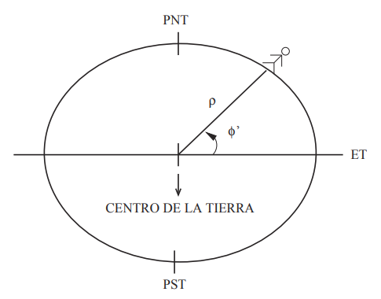
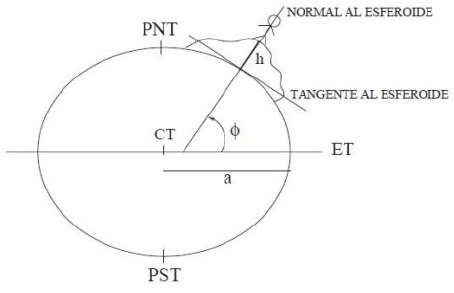
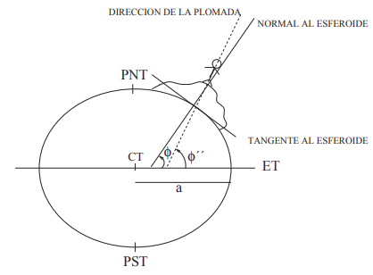

Son las coordenadas de un observador en la superficie de la Tierra

# Coordenadas geocéntricas

- Latitud geodésica:  
    Ángulo formado al centro de la Tierra  
    $$
    -90° \le \phi' \le 90°
    $$
    Se puede colocar $N(+)$ o $S(-)$
- Longitud geodésica $\lambda'$  
    $$
    -180° \le \lambda' \le 180°
    $$
    El signo positivo corresponde a girar con las manecillas del reloj.  
    Se puede colocar $E(+)$ o $W(-)$
- Distancia radial $\rho$  
    Se mide desde el centro de masa de la Tierra

# Coordenadas geodésicas

Se trazan sobre un elipsoide con valores fijos $a, f$
La latitud es la que se usa en mapas y atlas

- Latitud geodésica:
    Se traza con la normal a la tangente sobre el esferoide
    $$
    -90° \le \phi \le 90°
    $$
- Longitud geodésica $\lambda$
Equivale a $\lambda'$
- Altura sobre el esferoide $h$

# Coordenadas geográficas o astronómicas

- Latitud geográfica $\phi''$  
    Ángulo correspondiente a la plomada, depende del campo gravitacional.  
    No pasa por el centro del esferoide
- Longitud geográfica $\lambda''$
    Varía respecto a las anteriores

# Transformación de coordenadas geocéntricas a geodésicas

- Transformar la latitud:
$$
\tan \phi' = (1 - f)^2 \tan \phi
$$
- Hallar $\rho_0$ (distancia del centro a la superficie) para ese $\phi$:
$$
\rho_0  = a \sqrt{ \frac{1 - e^2(2-e^2) \sin^2 \phi}{1 - e^2 \sin^2 \phi}}
$$
- Hallar $\rho$  
  $\rho = \rho_0 + h$