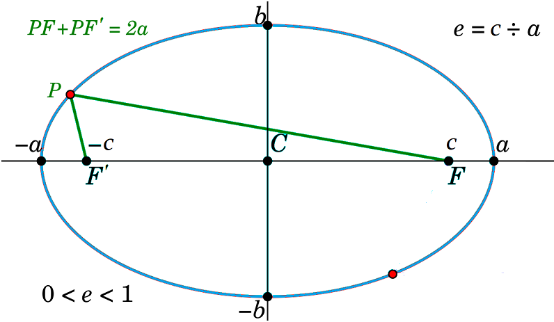
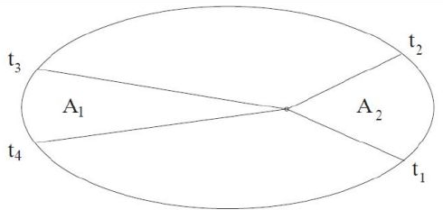
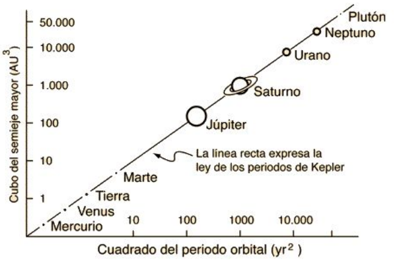

# Gravedad

La **mecánica celeste** estudia el movimiento de los cuerpos celestes utilizando las leyes de la mecánica newtoniana.

Actualmente usa la relatividad general.

## Leyes de Newton
1. Inercia
2. $F = ma$
3. Acción y reacción

## Fuerza centrípeta y movimiento orbital

La gravedad cumple el papel de fuerza centrípeta.

**Fuerza centrípeta** necesaria para que un objeto de masa $m$ se mueva en un círculo de radio $r$ con velocidad $v$:
$$
F_c = \frac{mv^2}{r}
$$

Fuerza gravitacional entre dos cuerpos de masa $m$ y $M$ separados a una distancia $r$:
$$
F_g = G \frac{Mm}{r^2}
$$

En una órbita se cumple que:
$$
\begin{align*}
    F_g &= F_c\\
    G \frac{Mm}{r^2} &= \frac{mv^2}{r}\\
    \sqrt{\frac{GM}{r}} &= v
\end{align*}
$$
se conoce como **velocidad orbital**. Corresponde a la velocidad tangencial que un cuerpo debe tener para mantenerse en órbita al rededor de otro cuerpo bajo la acción exclusiva de la fuerza gravitacional.

# Leyes de Kepler

## 1. Ley de las órbitas
Las órbitas de los planetas son elípticas, en uno de los focos está el Sol 

## 2. Ley de las áreas
El rayo que une al Sol con un planeta barre áreas iguales en tiempos iguales.

La velocidad en la órbita no es constante.

## 3. Ley de los períodos
La relación entre los cubos de los semiejes mayores y los cuadrados de los períodos es la misma para todos los planetas. Es decir, existe $K$ tal que:
$$
\frac{T_p^2}{a_p^3} = K
$$
sin importar el planeta $p$.

# Primera ley

## Geometría de la elipse

- $a$: longitud del semieje mayor
- $b$: longitud del semieje menor
- $c$: distancia a los focos

Se cumple que la suma de las distancias de cualquier punto a los focos es siempre la misma y es $2a$.

### Excentricidad:

Es la relación entre el semieje mayor y el menor:
$$
e = \frac{c}{a}
$$
como $c^2 = a^2 + b^2$ se tiene que:
$$
e^2 = 1 - \frac{b^2}{a^2}
$$

Usando $b = a(1-f)$ también se tiene que:
$$
e = \sqrt{f(2-f)}
$$

### Ecuación de la elipse 
Se quiere tener en cuenta al Sol como el centro de la ecuación, así que se traslada $x$ a $x + ae$, pues la distancia a un foco es $c = ae$. Entonces tomamos
$$
\frac{(x + ae)^2}{a^2} + \frac{y^2}{b^2} =1
$$
se llega a
$$
x^2 + y^2 = a^2 (1-e^2)^2 - 2aex(1-e^2) + x^2e^2
$$

#### Coordenadas polares
Usando
$$
x = r\cos \theta, \qquad y = r \sin \theta, \qquad x^2 + y^2 = r^2
$$
se obtiene la ecuación de la elipse en coordenadas polares con origen en uno de los focos:
$$
r = \frac{a(1-e^2)}{1+e \cos \theta}
$$

- $r$ se llama **radio vector**, corresponde a la distancia entre el centro del Sol y el centro del planeta
- $\theta$ se llama **anomalía verdadera**

Si $e = 0$, la elipse se convierte en un círculo y $r=a$, constante.

Si $\theta = 0$ o $\theta = 270°$
$$
r = a(1-e^2)
$$
a dicha distancia se le llama **semilatus rectum** y se denota con $p$

## Distancia al Sol

La línea que une los focos se llama **línea de las ápsides**.
- **Perihelio** $q$: menor distancia del planeta al Sol  
  corresponde a $\theta = 0$, $r = a(1 -e)$
- **Afelio** $Q$: mayor distancia del planeta al Sol  
  corresponde a $\theta = \pi$, $r = a(1+e)$
- **Distancia media**: corresponde al promedio
$$
r_{\mathrm{med}} = \frac{q+Q}{2}=a
$$

La unidad astronómica corresponde a la distancia media de la Tierra al Sol
$$
1 \mathrm{ua} = 149597870 \mathrm{km}
$$

# Segunda ley
$$
A = Kt
$$

se debe cumplir que 
$$
t_2 - t_1 = t_4 - t_3 \Longleftrightarrow A_1 = A_2
$$

Por la segunda ley $\theta(t)$ no es lineal. El planeta acelera cerca al perihelio y desacelera cerca al afelio

# Tercera ley 

$$
T^2 = K a^3
$$
quiere decir que los planetas más cercanos al Sol tienen un periodo de órbita menor.