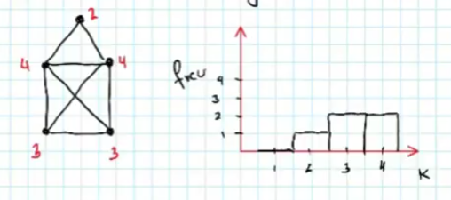

# Definición de Grafo

>[!definicion] Definición
>Un **grafo** $G$ es una tupla $(V,E)$ donde $V$ es el conjunto de vértices y $E$ el conjunto de aristas: $E \sube V \times V$

A los grafos también se les llama redes o networks:

| Grafos | Graphs | Networks|
|---|---|---|
|vértices| vertex | nodes
|aristas | edges | links

Las aristas pueden o no tener dirección. Si la hay se llaman **grafos dirigidos** o **digrafos**.

## Sobre el grad ode un vértice
>[!teorema] 
>El número de aristas de un grafo no dirigido sin loops es la suma de los grados dividido por dos.
>$$
> |E|= L = \frac{1}{2} \sum_{v \in V} gr(v)
>$$

Denotamos el grado de un vértice $i$ como $k_i$

>[!definicion] Definición
>Promedio de los grados:
>$$
>\langle K \rangle = \frac{\sum k_i}{n} = \frac{2L}{n}
>$$
Si el grafo es dirigido cada vértice tiene un grado de entrada y uno de salida:
$$
k_i = k_i^{in} + k_i^{out}
$$

La **distribución de los grados** dice cuántos vértices hay de cada grado.

## Matriz de adyacencia

Se coloca en el mismo orden los vértices en las filas y columnas. Se coloca $1$ si hay una arista entre los vértices.

- Como no hay loops, la diagonal principal es de $0$
- Si es no dirigido la matriz es simétrica

Al multiplicar por el vector $(1, \dots, 1)$ se obtiene el grado de los vértices.

## Algoritmos para obtener un árbol de expansión

## Número de cluster